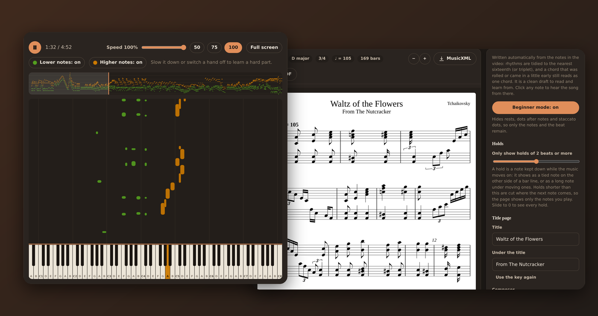
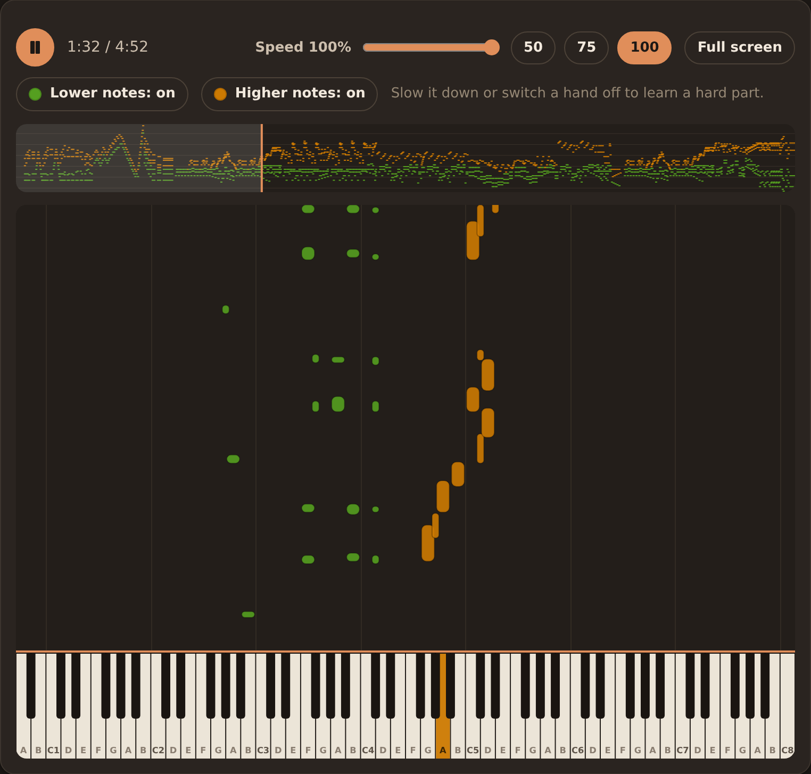
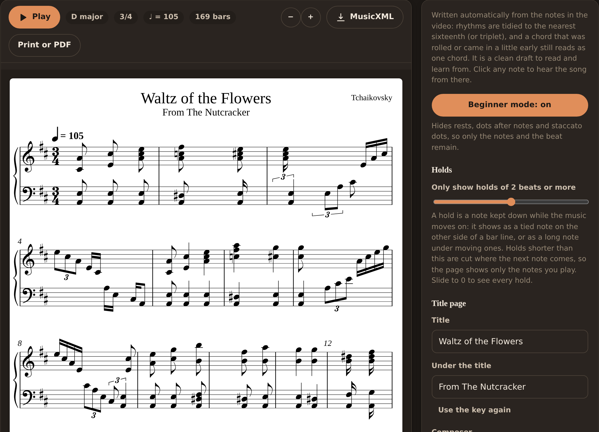
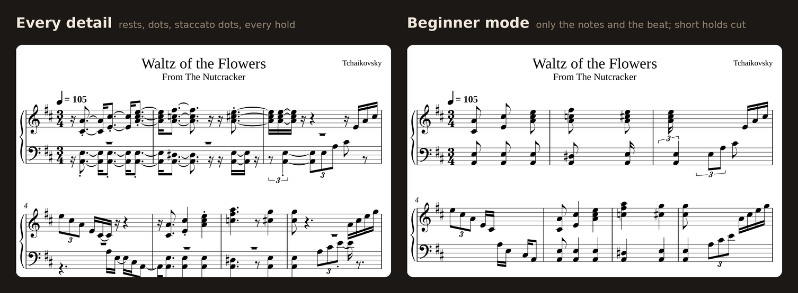
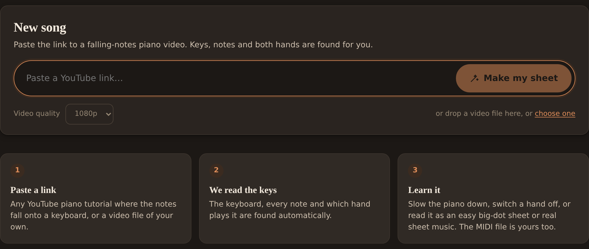
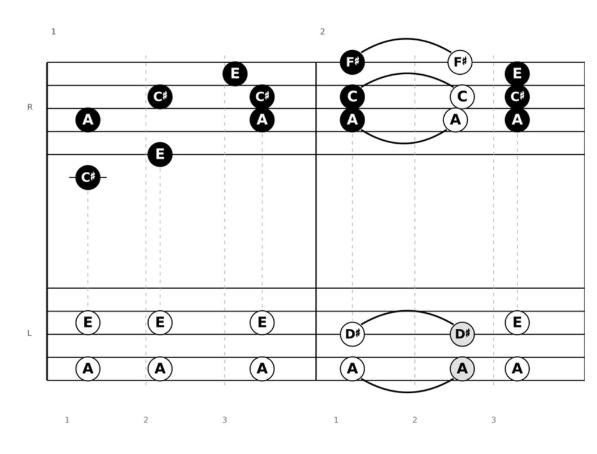
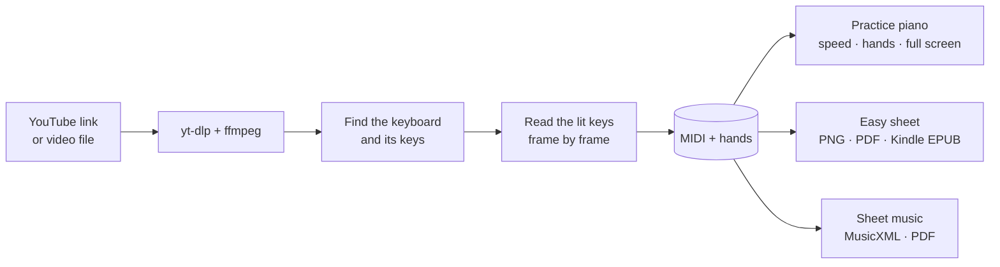

<div align="center">


# yt2midi

**Paste a YouTube piano video. Get the MIDI and the sheet music.**<br>
No calibration wizard, no transcribing by hand. The only thing you choose is how complex you want the notation.


[Download](#download) · [Why](#why-another-one) · [What you get](#what-you-get) · [Screenshots](#see-it) · [How it works](#how-it-works) · [Build it](#build-from-source) · [Roadmap](#roadmap)



</div>

---

## Why another one?

There are plenty of tools that turn a "Synthesia" falling-notes piano video into MIDI, and plenty that turn MIDI into a score.
Chain them together and you are drawing a mask over the keyboard, telling the tool which colour is which hand, fixing the key count,
exporting a MIDI, importing it into a notation editor, fixing the tempo, then cleaning up the rhythms until it looks like music.

**yt2midi does the whole chain for you.** Paste a link (or drop a video file), and a minute later you have the MIDI, a piano you can slow down,
and sheet music on the page. The keyboard, the keys, the hands, the tempo and the bar lines are all found automatically.
Your only manual work is at the end, and it is a taste question: *how much do you want to see on the page?*

| | The usual pipeline | yt2midi |
|---|---|---|
| Find the keyboard | draw it or supply a mask for each video layout | detected from the video |
| Number of keys and the first note | typed in | detected (partial keyboards too; the octave is a guess you can fix in one click) |
| Left and right hand | pick colours or tracks yourself | found by clustering the lit-key colours |
| Tempo and bar lines | set in a DAW or notation editor | tracked from the notes, bar numbers shared everywhere |
| Rhythm clean-up | quantize and fix by hand | chords, triplets, held notes and rests tidied for you |
| The result | a MIDI file, and a long evening | MIDI, a practice piano, an easy sheet, standard sheet music |
| Manual work | most of it | **how complex the notation should be** |

<sub>For example, [syn2midi](https://github.com/minyor/syn2midi) needs a mask image that matches each video's layout, and [SynToMid](https://github.com/emilamaj/SynToMid) is still a work in progress. yt2midi is not a replacement for a notation editor if you want to publish a score; see [Good to know](#good-to-know).</sub>

## No AI, no cloud, no GPU

**yt2midi is not an AI tool.** There is no LLM, no neural network, no trained model and no cloud API in it, and nothing to sign up for or pay per use.
Everything is ordinary computer vision and arithmetic, so it is fast, predictable (the same video always gives the same notes) and runs on a cheap, old machine:

- the keyboard is found by comparing frames, and a key is "pressed" when its colour moves away from its resting colour;
- the two hands come from clustering the hues of pressed keys;
- the beat is the strongest periodicity in the note onsets, and the key is the best match against fixed key profiles (Krumhansl–Schmuckler);
- the notation is rules: snap to a grid, merge notes struck together into chords, hold a note until the next one, split voices, spell by key.

A five-minute video takes about half a minute on an ordinary desktop. It needs no graphics card and downloads no models.
After the video itself is downloaded, everything happens on your computer.

## What you get

**From the video**
- 🎹 **YouTube link or a video file.** `yt-dlp` is fetched on first run and refreshed if a download fails; dropping a file on the window works too.
- 🔎 **Automatic keyboard and note detection**, with the two hands told apart by colour.
- 🎼 **A standard MIDI file**, one track per hand.

**Learn it**
- 🎬 **A practice piano** with the music falling onto all 88 keys, every white key labelled. Slow it down from 100% to 25%, switch a hand off (it goes quiet and disappears), jump around the song, or go full screen.
- 🔊 **Real piano sound** from sampled grand-piano recordings, played natively on the desktop.

**Read it**
- 🟠 **Easy sheet:** big dots with the note name inside, no rhythm to decode. Made for a Kindle (EPUB) or a printed A4 page (PDF).
- 🎼 **Sheet music:** real notation on a grand staff, with key signature, tempo, ties, triplets and beams, drawn by [Verovio](https://www.verovio.org). The notes light up while the song plays, click a note to hear from there, edit the title page, save **MusicXML** (opens in MuseScore, Finale, Sibelius…) or print it.
- 🎚️ **You decide the complexity:** a **Beginner mode** that hides rests, dots and staccato marks, a **hold slider** that cuts short tied-over notes, and a checklist for every other mark, each explained in plain words.

## See it

<table>
  <tr>
    <td width="50%"><br><sub><b>Practice piano.</b> Falling notes in each hand's colour, key names on the keys, speed and hands on/off.</sub></td>
    <td width="50%"><br><sub><b>Sheet music.</b> Title page, beginner mode and the hold slider on the right, MusicXML and print on top.</sub></td>
  </tr>
</table>

**The same four bars, two levels of detail.** One click on Beginner mode:



**And the rest of the app.** The home page is a link box and a drop zone; the Easy sheet puts the pitch on the staff lines and the note name inside a big dot (black dots are the right hand, white dots the left, held notes get a curve).

<table>
  <tr>
    <td width="58%"><br><sub><b>Home.</b> Paste a link or drop a video file; the keys, notes and both hands are found for you.</sub></td>
    <td width="42%"><br><sub><b>Easy sheet.</b> Big dots with note names, for a Kindle (EPUB) or a printed page (PDF).</sub></td>
  </tr>
</table>

## Download

yt2midi is a desktop app for **Windows and Linux**: one small program with everything inside. No Python, no browser extension, no account.

| | |
|---|---|
| **Windows 10 / 11** | [`yt2midi_x64-setup.exe`](https://github.com/GabrielDornelles/yt2midi/releases/latest) · installs for your user, no administrator needed |
| **Debian / Ubuntu** | [`yt2midi_amd64.deb`](https://github.com/GabrielDornelles/yt2midi/releases/latest) · `sudo apt install ./yt2midi_*_amd64.deb` |
| **Other Linux** | [build it from source](#build-from-source) (a few minutes the first time) |

Windows may say the publisher is unknown, because the installer is not code-signed yet: choose **More info → Run anyway**.

**What it downloads.** To read a video it needs `ffmpeg`; to fetch from YouTube it needs `yt-dlp` (and Deno, if you have no JavaScript runtime).
If they are not on your computer, the app downloads its own copies **once**, the first time you make a sheet (about 145 MB for `ffmpeg`), into
`%APPDATA%\yt2midi\bin` on Windows or `~/.local/share/yt2midi/bin` on Linux. The Windows installer tells you this. Nothing else leaves your computer.

## Using it

1. **Paste a YouTube link** (or drop a video file anywhere on the window) and press *Make my sheet*. A five-minute 1080p video takes about half a minute on a desktop machine.
2. **Check the Overview.** Play it, slow it down, switch a hand off. If the octave looks off or a note is missing, the *Adjust* tab fixes the keyboard and redoes the notes.
3. **Open the sheet you want.** *Easy sheet* for dots and note names, *Sheet music* for standard notation. Then choose how much to show, and download or print.

### How much to show

| Control | What it does |
|---|---|
| **Beginner mode** | One click: hides rests, dots after notes and staccato dots, so only the notes and the beat remain. |
| **Holds slider** | Notes held for less than the chosen number of beats lose their tied tails and end where the next note comes. Default 2 beats; 0 shows every hold. |
| **Checklist** | Rests · ties · dots · staccato · triplet numbers · sharps, flats and naturals · bar numbers. Each says in plain words what the symbol is and what it asks of the player. |
| **Key** | The key is detected for you; if you know it is another (say A♭ major, not the C♯ major that fitted the notes best), choose it and every note is re-spelled and the key signature rewritten to match. |
| **Title page** | Title, the line under it (starts as the key), composer and arranger, written on the sheet like a printed score. |

The key signature and tempo mark are always shown.

## How it works



- **Keyboard and notes.** The keyboard is found from a median of frames; every key's colour is compared with its resting colour in a perceptual (Lab) colour space, with hysteresis so flicker does not become notes. The two hands come from clustering the hues of pressed keys.
- **Bars and tempo.** The beat is the strongest periodicity in the note onsets, and the first bar line is where low notes fall most often (the "oom" of oom-pah-pah). The Easy sheet uses that. The Sheet music tab does the same for a human-played piece, but when the chords sit on a perfectly regular pulse (a machine-made MIDI) it tries a few tempos and meters and keeps the one that gives the cleanest page: fewest ties, rests and short notes, with a new chord on most bar lines. You can also choose how many beats a bar has, or use the Easy sheet's bars.
- **From MIDI to notation.** A beat tracker follows a drifting tempo, notes within a few hundredths of a second become one chord, everything snaps to a grid of sixteenths (or triplets where the music clearly is), notes last until the next one unless there is a real gap, a note held under moving ones becomes a second voice, each staff changes clef when it dives low or climbs high so notes stay on the staff, and the key is estimated so notes are spelled sensibly (E♭, not D♯, in a flat key). The result is written as MusicXML and drawn by Verovio.

## Build from source

You need [Rust](https://rustup.rs) 1.90 or newer, Node 18+ and Git.

| | Also needed |
|---|---|
| **Linux** | `ffmpeg`, plus the usual [Tauri prerequisites](https://v2.tauri.app/start/prerequisites/#linux): `libwebkit2gtk-4.1-dev`, `libgtk-3-dev`, `libasound2-dev` |
| **Windows** | the "Desktop development with C++" part of the [Visual Studio Build Tools](https://visualstudio.microsoft.com/visual-cpp-build-tools/) and Git for Windows (for its `bash`). WebView2 is already part of Windows 10/11. `ffmpeg` is fetched by the app |

```sh
git clone https://github.com/GabrielDornelles/yt2midi.git && cd yt2midi
bash scripts/fetch-piano.sh                           # the piano samples (a few MB, CC BY 3.0)
cd frontend && npm install && npm run build && cd ..  # the page gets embedded into the program
cd app && cargo run --release -p yt2midi              # opens the app
```

An installable package: `cargo install tauri-cli --locked`, then in `app/desktop` run `cargo tauri build --bundles deb` (Linux) or `cargo tauri build --bundles nsis` (Windows).
The release workflow in `.github/workflows` builds both whenever a version tag is pushed.

Prefer a browser tab? `cargo run --release -p yt2midi-core` runs the same engine with no window and serves it at `http://127.0.0.1:8000`.

## Good to know

- It reads **falling-notes videos with a fixed camera and the keyboard visible**. Partial keyboards work; the octave is then a guess (the app tells you when it is unsure).
- The sheet music is a **clean draft to read and learn from**, not an engraver's transcription: the source is a performance, so there is no way to know the "correct" rhythm. Expect to polish it in MuseScore if you want to publish it.
- Very fast passages are written in sixteenths (no 32nd notes yet), and the time signature is always *n/4*. A song that feels like 6/8 can be written with six beats per bar in the Easy sheet's timing settings.
- Songs that change tempo a lot may drift: bar lines follow the tempo near the start.
- Runs on **Windows and Linux**. The code also targets macOS, but there is no macOS build yet.

<details>
<summary><b>Configuration</b></summary>

| Setting | Meaning |
|---|---|
| `~/.local/share/yt2midi` or `%APPDATA%\yt2midi` | the data folder: `songs`, and `bin` with the helper programs (`YT2MIDI_HOME` moves it, `YT2MIDI_WORK` moves only the songs) |
| `YT2MIDI_WINDOW=webview` | Linux only: force the built-in web view. By default the window is a Chrome, Chromium, Brave or Edge app window if one is installed, because the system web view (WebKitGTK) is capped at 60 fps and scrolls roughly. Windows always uses WebView2 |
| Downloads | MIDI, PDF, EPUB, PNG and MusicXML you save are written to your Downloads folder |

</details>

<details>
<summary><b>Repository layout and development</b></summary>

```
app/core/       Rust engine: video → notes → MIDI → sheets, plus the HTTP API and native piano playback
app/desktop/    Rust desktop shell (Tauri), the installer settings and the Windows installer notice
frontend/       React + TypeScript web app (Vite)
docs/           README images
.github/        CI (tests, Windows compile check) and the release workflow
```

```sh
cd app && cargo test --release          # engine tests (needs ffmpeg and the piano samples)
cd frontend && npm run dev              # web app on :5173 (run the engine on :8000 first, it proxies /api)
cd frontend && npm run build            # type-checks and builds frontend/dist
```

</details>

## Roadmap

- [x] YouTube link or video file → MIDI, with hands, fully automatic
- [x] Practice piano with speed and per-hand control
- [x] Easy sheet (PDF, Kindle EPUB) and standard sheet music (MusicXML, PDF)
- [x] Beginner mode, an adjustable hold length, a choice of key and of bars
- [x] Windows installer and Debian/Ubuntu package, built by the release workflow
- [ ] Play along with a MIDI keyboard (the song waits for you)
- [ ] 32nd notes and compound meters (6/8, 12/8)

Ideas and bug reports are welcome in the issues.

## Credits

Built on the shoulders of [yt-dlp](https://github.com/yt-dlp/yt-dlp), [FFmpeg](https://ffmpeg.org), [Tauri](https://tauri.app),
[Verovio](https://www.verovio.org) (LGPL-3.0, sheet music engraving), [midly](https://github.com/kovaxis/midly), [tiny-skia](https://github.com/RazrFalcon/tiny-skia),
[cpal](https://github.com/RustAudio/cpal), [symphonia](https://github.com/pdeljanov/Symphonia) and [Vite](https://vitejs.dev).
Piano sound: the [Salamander Grand Piano](https://sfzinstruments.github.io/pianos/salamander/) by Alexander Holm (CC BY 3.0).

## A note on videos

yt2midi does not host or share any videos or music. It downloads with `yt-dlp` on your computer, for your own study. Respect the creators of the videos you use
and the copyright of the music you transcribe.
